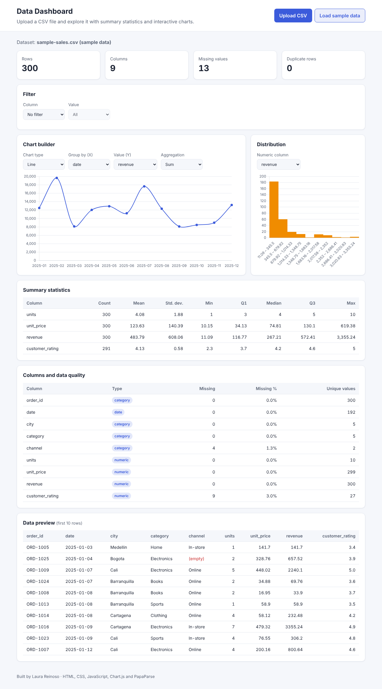

# Data Dashboard

An interactive dashboard that turns any CSV file into summary statistics, data-quality checks and charts — directly in the browser, with no installation and no server.

**Live demo:** https://lauravanessa-r.github.io/data-dashboard/



## Features

- **Upload any CSV** with the button or by dragging and dropping the file, or load the included sample dataset.
- **Automatic column type detection:** each column is classified as numeric, date or category.
- **Data-quality overview:** total rows, columns, missing values and duplicate rows, plus missing values and unique values per column.
- **Summary statistics** for every numeric column: count, mean, standard deviation, min, Q1, median, Q3 and max.
- **Chart builder:** choose a bar, line or doughnut chart, the column to group by and the aggregation (sum, average or count). Dates are grouped by month.
- **Distribution chart:** histogram of any numeric column, with the number of bins set by Sturges' rule.
- **Filter** the whole dashboard by the values of any category column.
- **Data preview** of the first 10 rows, with empty cells highlighted.
- **Privacy:** the file is processed in the browser and never sent to a server.
- Responsive layout and automatic light/dark mode.

## Built with

- HTML5, CSS3 and vanilla JavaScript (ES6+)
- [Chart.js](https://www.chartjs.org/) for the charts
- [PapaParse](https://www.papaparse.com/) for reading CSV files

## Project structure

```
data-dashboard/
├── index.html            # Page layout
├── style.css             # Styles, light/dark theme and responsive design
├── js/
│   ├── stats.js          # Statistics functions (mean, quantiles, std. dev., histogram)
│   └── app.js            # CSV loading, type detection, filters, charts and tables
├── data/
│   └── sample-sales.csv  # Sample dataset (synthetic)
└── assets/
    └── screenshot.png
```

## How it works

1. **Parsing:** PapaParse reads the CSV and returns one object per row, using the first row as headers.
2. **Type detection:** a column is treated as numeric (or date) when at least 90% of its non-empty values can be read as numbers (or as dates). Everything else is a category.
3. **Statistics:** quantiles use linear interpolation, the same method as Excel's `PERCENTILE.INC` and R's default `quantile()`. The standard deviation is the sample standard deviation (n − 1).
4. **Charts:** rows are grouped by the selected column and aggregated; category charts show the top 15 groups.

## Run it locally

Clone the repository and start a simple local server (needed to load the sample file):

```bash
git clone https://github.com/lauravanessa-r/data-dashboard.git
cd data-dashboard
python -m http.server 8000
```

Then open http://localhost:8000. You can also use the **Live Server** extension in Visual Studio Code.

## Sample data

`data/sample-sales.csv` contains **synthetic data** created for demonstration purposes: 300 sales orders from 2025 across five Colombian cities, with columns for date, city, category, channel, units, unit price, revenue and customer rating. A few values were intentionally left empty to show the data-quality checks.

## Possible improvements

- Export the summary statistics as CSV
- Support for numbers written with a comma as decimal mark (e.g. `3,5`)
- Correlation matrix between numeric columns
- Box plots to detect outliers

## Author

**Laura Reinoso** — Statistician · Data Annotator · Front-end Developer
[LinkedIn](https://www.linkedin.com/in/) · [GitHub](https://github.com/lauravanessa-r)

## License

This project is licensed under the [MIT License](LICENSE).
